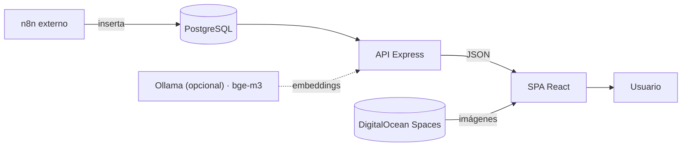

# VORAEL

Banco de imágenes generadas por IA — Corporación Universitaria Americana.

Catálogo web de **solo lectura** sobre un archivo de imágenes generadas por IA:
grid con scroll infinito, búsqueda por palabras o por significado, filtros,
etiquetas, vista de grafo y descarga en WebP, PNG o JPG.

- **Producción:** https://n8n.americana.edu.co/vorael/
- **Repositorio:** https://github.com/epimient/Buscador_grafos

## Características

- **Grid infinito** con paginación por cursor (TanStack Query).
- **Búsqueda en 3 modos**: `lexical` (palabras), `semantic` (significado) e
  `hybrid` (fusión de ambos). El usuario puede cambiar de modo desde la UI.
- **Filtros** por estilo, mood y caso de uso; **páginas de tags** y **stats**.
- **Vista de grafo** (`vis-network`): imágenes + metadatos compartidos, con
  resaltado de vecinos al hacer clic.
- **Imágenes relacionadas** por vecindad en el grafo.
- **Descarga** reconvertida con `sharp` (WebP/PNG/JPG) y, opcionalmente, con
  metadatos incrustados (EXIF/IPTC/XMP).

## Cómo está armado

Monorepo **pnpm** con dos aplicaciones:

| | Stack | Rol |
|---|---|---|
| [`apps/web`](apps/web) | React 18 · Vite · TypeScript · Tailwind · TanStack Query · vis-network | SPA servida como estáticos bajo `/vorael/` |
| [`apps/api`](apps/api) | Express 4 · TypeScript (CommonJS) · `pg` · AWS SDK v3 · `sharp` · Graphology | API REST en `127.0.0.1:3001`, expuesta en `/vorael/api/` |

Servicios que consume:

- **PostgreSQL** — tabla `generated_images` (~53k filas), de donde salen todos
  los metadatos. VORAEL solo lee. La tabla `image_embeddings` (si existe) guarda
  los vectores semánticos.
- **DigitalOcean Spaces** (S3, bucket `n8ns3`) — los archivos de imagen. El grid
  los carga directo desde Spaces; las descargas pasan por el API.

Quien llena la base es un flujo de **n8n** externo a este repositorio.



## Requisitos

- **Node ≥ 20** y **pnpm 11.3.0** (`corepack enable` lo instala solo).
- **Docker + Docker Compose** — para Postgres local y el stack completo.
- *(Opcional)* **Ollama** + `bge-m3` — solo para búsqueda semántica/híbrida.
- *(Opcional)* **exiftool** — solo para incrustar metadatos en las descargas.

> La búsqueda semántica **no es obligatoria**: sin Ollama la app funciona en modo
> léxico (y degrada a léxico automáticamente si el modelo no responde).

## Arrancar en local

### Opción A — Stack completo en Docker (recomendado)

Levanta **PostgreSQL + API + web** juntos. `api` y `web` usan
`network_mode: host` para alcanzar el Ollama del host (`127.0.0.1:11434`):

```bash
sudo docker compose up -d --build
sudo docker compose logs -f api      # boot del grafo (~17s) + índice semántico
```

Abrir **http://localhost:5173/vorael/**. Para bajar: `sudo docker compose down`
(el volumen `pgdata` persiste). Detalle en [ARQUITECTURA.md §2.4](ARQUITECTURA.md)
y [DEPLOY.md](DEPLOY.md).

### Opción B — `pnpm dev` (API + web en el host, Postgres en Docker)

```bash
pnpm install
cp apps/api/.env.example apps/api/.env
cp apps/web/.env.example apps/web/.env
# rellenar apps/api/.env con las credenciales de Postgres y Spaces
sudo docker compose up -d postgres   # Postgres en el puerto 5433
pnpm --filter api seed:db            # carga 30 imágenes de prueba
pnpm dev                             # API :3001 + web :5173
```

Abrir **http://localhost:5173/vorael/** (con la barra final: es la `base` de Vite
y el `basename` del router).

> `pnpm dev` y el stack Docker **no pueden convivir**: ambos usan los puertos
> 3001/5173.

### Opción C — Todo mock (sin servicios externos)

Para ver la app sin Postgres, sin S3 y sin IA (30 imágenes de prueba):

```bash
cp apps/api/.env.example apps/api/.env
cp apps/web/.env.example apps/web/.env
# en apps/api/.env agregar:  DB_MOCK=true
pnpm dev
```

`DB_MOCK` viene en `false` por defecto, por eso hay que ponerlo explícito.

## Datos: prueba vs. reales

| Comando | Qué hace |
|---|---|
| `pnpm --filter api seed:generate` | Genera y siembra 1000 filas sintéticas (`gen-*`) en Postgres (`DB_MOCK=false`) |
| `pnpm --filter api seed:generate:clear` | Borra las filas `gen-*` y re-siembra |
| `pnpm --filter api seed:db` | Carga las 30 imágenes de `mockData.ts` en Postgres |
| `pnpm --filter api snapshot:prod` | Copia toda la tabla real (por túnel SSH) a tu Postgres local |
| `pnpm --filter api embeddings:build` | Construye la tabla `image_embeddings` con Ollama (reanudable) |

Ver **[docs/INSTALACION.md](docs/INSTALACION.md)** para el paso a paso con
producción real (túnel SSH + credenciales).

## Motor de búsqueda

Dos motores en paralelo sobre un **grafo in-memory (Graphology)** sincronizado
con PostgreSQL, y un tercer modo que los fusiona:

- **Léxico** — por palabras. Filtra **stopwords en español**, hace *token-match*
  de palabra completa y exige una **cobertura mínima** (≥75% de los términos
  significativos en frases de 3+; cualquiera en 1–2). Score por término:
  **tag +4 · subject +2 · prompt +1**.
- **Semántico** — por significado, con embeddings **`bge-m3`** (Ollama) y
  similitud coseno. En `hybrid` el feed semántico se filtra con
  `SEMANTIC_MIN_SCORE` (default `0.65`) como control anti-ruido.
- **Híbrido** (modo de producción) — fusiona ambos rankings con **RRF**
  (*Reciprocal Rank Fusion*), alimentado con el top-100 léxico + top-100
  semántico.

El grafo se refresca **incrementalmente** cada 60 s (delta por watermark) y se
**reconstruye** por completo cada 10 min (reconcilia borrados/ediciones).

Introducción simple: **[docs/GUIA_BUSQUEDA.md](docs/GUIA_BUSQUEDA.md)**. Semántica
a fondo: [docs/GUIA_EMBEDDINGS.md](docs/GUIA_EMBEDDINGS.md). Decisiones del grafo:
[docs/PLAN_GRAFOS.md](docs/PLAN_GRAFOS.md). Detalle técnico:
[ARQUITECTURA.md §4](ARQUITECTURA.md).

### Búsqueda semántica (opcional, Ollama)

```bash
ollama pull bge-m3                 # ~1.2 GB, 1024 dims
# construir el índice contra tu base:
pnpm --filter api embeddings:build
```

Activar en `apps/api/.env`:

```dotenv
SEARCH_MODE=hybrid        # lexical | semantic | hybrid
EMBED_MODEL=bge-m3
EMBED_DIM=1024
SEMANTIC_MIN_SCORE=0.65
```

Sin esto, la búsqueda queda en `lexical` y todo lo demás funciona igual.

## Sub-ruta `/vorael/`

La app se sirve bajo la sub-ruta `/vorael/`, **hardcodeada en 4 lugares**:
`apps/web/vite.config.ts` (`base`), `apps/web/src/main.tsx`
(`BrowserRouter basename`), `deploy/nginx-vorael.conf` (`location`) y
`index.html` (favicon). Cambiar uno sin los otros rompe la app.

## API — endpoints principales

| Ruta | Qué hace |
|---|---|
| `GET /api/health` | Estado del sistema (grafo, modo de búsqueda, modelo) |
| `GET /api/images` | Grid paginado (`page`, `limit`, `style`, `mood`, `use_case`) |
| `GET /api/images/:id` | Detalle de una imagen |
| `GET /api/images/:id/download` | Descarga (`format=webp\|png\|jpg`, opcional metadatos) |
| `GET /api/images/:id/related` | Imágenes relacionadas (vecinos del grafo) |
| `GET /api/search?q=…` | Búsqueda (`mode=lexical\|semantic\|hybrid`, `graph=1`) |
| `GET /api/graph` | Grafo para vis-network (`types`, `limit`, `center`, `hops`, `ids`) |
| `GET /api/tags` · `/api/tags/:tag/images` | Tags y sus imágenes |
| `GET /api/filters` · `GET /api/stats` | Facetas y estadísticas |

Mapa completo: **[docs/CHEATSHEET.md](docs/CHEATSHEET.md)**.

## Variables de entorno

`apps/api/.env` (plantilla en `apps/api/.env.example`):

| Variable | Defecto | Descripción |
|---|---|---|
| `DB_MOCK` | `false` | Modo mock (sin DB/S3) |
| `DB_HOST` / `DB_PORT` / `DB_NAME` / `DB_USER` / `DB_PASSWORD` / `DB_SSL` | — / `5432` | PostgreSQL (Docker local: `localhost:5433`) |
| `S3_ENDPOINT` / `S3_BUCKET` / `S3_ACCESS_KEY` / `S3_SECRET_KEY` / `S3_REGION` | — | DigitalOcean Spaces |
| `SEARCH_ENGINE` | `graph` | `graph` (in-memory) o `sql` (fallback) |
| `SEARCH_MODE` | `lexical` | `lexical` / `semantic` / `hybrid` |
| `EMBED_MODEL` / `EMBED_SERVER` / `EMBED_DIM` | `bge-m3` / `http://127.0.0.1:11434` / `1024` | Modelo y Ollama local |
| `SEMANTIC_MIN_SCORE` | `0.65` | Umbral de coseno (solo feed semántico del `hybrid`) |
| `GRAPH_REFRESH_MS` / `GRAPH_FULL_RELOAD_MS` | `60000` / `600000` | Refresco delta / rebuild completo |
| `METADATA_EMBED` | `none` | `exiftool` para incrustar metadatos en descargas |
| `PORT` / `HOST` / `CORS_ORIGIN` | `3001` / `127.0.0.1` / `*` | Servidor Express |

`apps/web/.env` (plantilla en `apps/web/.env.example`):

| Variable | Dev | Producción |
|---|---|---|
| `VITE_API_URL` | vacío (usa el proxy de Vite) | `/vorael` |
| `VITE_BASE_PATH` | `/vorael/` | `/vorael/` |

## Scripts

Desde la raíz del monorepo:

| Comando | Qué hace |
|---|---|
| `pnpm dev` | API (`:3001`) y web (`:5173`) en paralelo |
| `pnpm dev:api` · `pnpm dev:web` | una sola app |
| `pnpm build` | compila ambas |
| `pnpm build:api` · `pnpm build:web` | compila una |
| `pnpm test` | tests de la API (Vitest) · `test:watch` · `test:coverage` |
| `pnpm probe:search` | sonda de búsqueda contra la API real (ver abajo) |
| `pnpm release` | empaqueta `release/vorael-{web,api}.tar.gz` |

Scripts de la API (`pnpm --filter api <script>`, o `cd apps/api && pnpm <script>`):

| Comando | Qué hace |
|---|---|
| `typecheck` | `tsc --noEmit` |
| `seed:db` · `seed:generate` (`:clear`) | Datos de prueba en Postgres |
| `snapshot:prod` | Réplica de producción → Postgres local |
| `embeddings:build` | Genera `image_embeddings` (Ollama) |
| `search:probe` | Dispara frases contra la API y muestra cuántos/cuáles resultados devuelve cada modo |
| `scan` | Reconstruye el grafo desde archivos (recovery) |
| `export-portable` | Exporta imágenes con metadatos a disco |
| `backfill` | Reescribe archivos en S3 con metadatos (requiere `ALLOW_BACKFILL_WRITE=true`) |

### Sonda de búsqueda

`pnpm probe:search` pega contra la API en vivo (`http://localhost:3001`) con una
lista de frases y muestra, por modo (`lexical`/`hybrid`/`semantic`), el total de
resultados y los primeros ítems. Las frases se editan en el array `PHRASES` de
`apps/api/src/scripts/search-probe.ts`. Variables: `API_BASE`, `PROBE_MODES`,
`PROBE_LIMIT`.

## Tests

```bash
pnpm test            # 152 tests (Vitest)
pnpm test:watch
pnpm test:coverage
```

No requieren servicios externos: usan `mockData.ts` y `test/fixtures/images.ts`.
`metadata.test.ts` y `exif.test.ts` degradan a fallback si exiftool no está.

Verificación antes de commitear:

```bash
cd apps/api && npx tsc --noEmit && npx vitest run
cd apps/web && npx tsc --noEmit
```

## Metadatos incrustados

Las descargas pueden llevar metadatos XMP/EXIF/IPTC incrustados (namespace
`XMP-vorael:`), equivalentes al frontmatter YAML de Obsidian. Requiere
`METADATA_EMBED=exiftool`. Ver [ARQUITECTURA.md §3.6.1](ARQUITECTURA.md).

## Documentación

- **[docs/INSTALACION.md](docs/INSTALACION.md)** — replicar el proyecto en otra
  computadora (mock / Docker / réplica de producción) y conectarlo a producción.
- **[docs/GUIA_BUSQUEDA.md](docs/GUIA_BUSQUEDA.md)** — cómo funciona una búsqueda
  de punta a punta (léxico + semántico + fusión RRF), explicado simple.
- **[docs/CHEATSHEET.md](docs/CHEATSHEET.md)** — mapa rápido del API: endpoints,
  flujo de búsqueda, motor de grafos, modos de operación.
- **[docs/VORAEL_GUIA_COMPLETA.md](docs/VORAEL_GUIA_COMPLETA.md)** — guía completa
  del sistema en tono introductorio (para presentaciones).
- **[docs/GUIA_EMBEDDINGS.md](docs/GUIA_EMBEDDINGS.md)** — búsqueda semántica a
  fondo: embeddings, pipeline de generación, RRF y verificación.
- **[ARQUITECTURA.md](ARQUITECTURA.md)** — cómo funciona, a dónde se conecta, las
  rutas del API, el esquema de las tablas, las variables de entorno, el motor de
  grafos y la sub-ruta `/vorael/`.
- **[DEPLOY.md](DEPLOY.md)** — despliegue paso a paso en el servidor: Nginx,
  systemd, estructura de directorios, exiftool y verificación.
- **[docs/PLAN_GRAFOS.md](docs/PLAN_GRAFOS.md)** ·
  **[docs/PLAN_EMBEDDINGS.md](docs/PLAN_EMBEDDINGS.md)** — planes de diseño de
  los motores de búsqueda.

## Secretos

Ningún `.env` real está en el repositorio. Los `.env.example` son plantillas con
los valores sensibles en blanco; las credenciales reales se rellenan a mano en
cada máquina y en el servidor.
