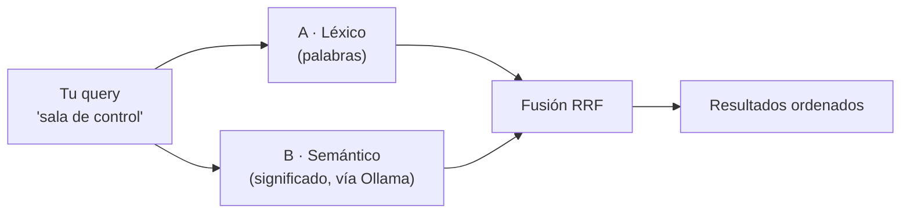

# VORAEL — Cómo funciona una búsqueda (explicado simple)

> Guía de entrada, pensada para entenderse sin leer código.
> Para el detalle profundo: [GUIA_EMBEDDINGS.md](GUIA_EMBEDDINGS.md) (buscador
> semántico), [VORAEL_GUIA_COMPLETA.md](VORAEL_GUIA_COMPLETA.md) (buscador
> léxico) y [ARQUITECTURA.md §4](../ARQUITECTURA.md).

---

## La idea en una frase

Cuando escribes algo en el buscador, **corren dos buscadores distintos en
paralelo** y después se **fusionan** sus resultados:

- **Buscador A — el literal (léxico):** busca por *palabras*.
- **Buscador B — el que entiende (semántico):** busca por *significado*.
- **Fusión — el híbrido (RRF):** combina las dos listas en un solo ranking.

Ese tercer paso es el que usás por defecto.



---

## Buscador A — el literal (léxico)

Es el clásico "buscar texto", pero más cuidadoso que un simple `ILIKE '%gato%'`
(que hacía match en "cate**goría**"). Corre **en memoria** sobre el grafo: no
consulta la base por cada letra.

### Paso 1 · Quita las palabras vacías (stopwords)

Primero separa tu frase en palabras y **descarta las que no aportan
significado**: artículos, preposiciones y conjunciones ("de", "la", "una",
"frente", "a"…). La lista vive en [`src/stopwords.ts`](../apps/api/src/stopwords.ts).

```
"persona parada frente a una sala de control"
   → 8 palabras  →  solo 4 cuentan:  [persona, parada, sala, control]
```

Por qué importa: si "de" o "frente" contaran como aciertos, cualquier imagen
mencionando "sala de espera" entraría como resultado válido. Eso es ruido.

### Paso 2 · Coincidencia por palabra completa (no por trozo)

Cada término debe aparecer como **palabra completa** (con plural mínimo y
acentos normalizados):

```
[SÍ] "gato"  matchea: "gato", "gatos"
[NO] "gato"  NO matchea: "categoría", "dátiles"
```

### Paso 3 · Puntúa según dónde aparece

No todas las coincidencias valen igual. Cada término suma puntos según el campo
donde aparezca; **una vez que el término coincide, cuenta como un único match**
aunque esté en varios campos a la vez.

| Dónde aparece el término | Puntos |
|---|---|
| en una **tag** (`tags`) | **+4** |
| en el **subject** | **+2** |
| en el **prompt original** (`original_prompt`) | **+1** |
| en el **prompt mejorado** (`enhanced_prompt`) | **+1** |

Ejemplo con la query `cat sunset`:

```
Imagen 1: tags=[cat, sunset, nature], subject="Cat at sunset"
  cat   → tag +4, subject +2   → 6
  sunset→ tag +4, subject +2   → 6      TOTAL = 12  [TOP]

Imagen 2: tags=[cat, library], subject="Cat in library"
  cat   → tag +4               → 4
  sunset→ (no aparece)         → 0      TOTAL = 4

Imagen 3: tags=[dog, park]
  cat   → 0 ; sunset → 0                TOTAL = 0
```

### Paso 4 · Filtro de cobertura (para frases largas)

Coincidir con *una* palabra no alcanza para una frase larga. VORAEL exige un
mínimo de términos coincidentes (`minMatched`):

- **1 o 2 términos** → basta con **uno** (comportamiento OR: `cat spaceship`
  devuelve las imágenes que tengan "cat").
- **3 o más términos** → se exige **el 75 %** de los términos significativos
  (`floor(n × 0.75)`).

```
"cat sunset"                     → 2 términos → basta 1
"persona parada frente a una
 sala de control"                → 4 términos → exige 3
```

El 75 % pide *casi toda* la frase, y así se descartan matches parciales como
"sala de espera" (que solo comparte "sala" y "persona").

### Paso 5 · Ordena y devuelve

Orden: **score DESC → `created_at` DESC → `id` DESC** (empates estables).

---

## Buscador B — el que entiende (semántico)

Aquí **no busca palabras, busca significados**. Para eso usa *embeddings*.

### ¿Qué es un embedding? (analogía)

Imagina un mapa gigante donde cada frase es una **flecha**. Dos frases que
significan lo mismo apuntan **en la misma dirección**, aunque no compartan ni una
palabra ("automóvil" y "vehículo urbano" quedan cerca).

El modelo `bge-m3` convierte cualquier texto en **1024 números** que son esa
dirección.

### El modelo: bge-m3 (en Ollama)

- Corre **local**, en [Ollama](https://ollama.com), en `http://127.0.0.1:11434`.
- Es un modelo de **embeddings** (familia BERT, ~566 M de parámetros), **no un
  chat**: no escribe ni razona, solo traduce texto → vector.
- **Dónde se usa:**
  1. **Una sola vez al construir los datos** (`pnpm embeddings:build`): se pasó el
     *texto* de cada imagen y se guardaron los 1024 números en la tabla
     `image_embeddings`.
  2. **En cada búsqueda** `semantic`/`hybrid`: convierte *tu query* en un vector.

### De qué texto salen los vectores (importante)

Los vectores salen **de la metadata de la imagen** (subject + estilo/mood/uso +
tags + prompt mejorado), **no de los píxeles**. O sea: el modo semántico entiende
sinónimos y frases, pero no "ve" la foto.

### Cómo compara: similitud coseno

Se mide el **ángulo** entre tu flecha y cada una de las 53 839 flechas que están
en RAM (`cosine`, en [`embeddings.ts`](../apps/api/src/embeddings.ts)):

- **1.0** → apuntan igual → mismo significado.
- **0.0** → perpendiculares → nada que ver.

Devuelve las mejores, ordenadas por coseno.

### Top-100 y el umbral 0.65

- Se conservan solo los **100 mejores** por coseno.
- El umbral **`SEMANTIC_MIN_SCORE` (0.65) se aplica únicamente al feed semántico
  del modo híbrido** (ver más abajo). En `mode=semantic` puro va con umbral `0`,
  porque pedís los top-100 directos.

### Cache

Convertir tu query a vector tarda unos cientos de milisegundos. La misma query
repetida sale de una **cache LRU** (512 entradas) y es instantánea.

---

## Buscador C — el híbrido (RRF)

Este es el corazón del sistema. **RRF = Reciprocal Rank Fusion** (fusión por
rango recíproco).

### El problema que resuelve

Dos rankings con **escalas incomparables**: el léxico da puntajes como `12`, el
semántico da cosenos como `0.78`. **No se pueden sumar.** Entonces se combinan por
**posición** (1º, 2º, 3º…), no por puntaje.

### La fórmula

```
Para cada imagen que aparece en alguna de las dos listas:

  rrf_score = 1/(60 + posición_en_léxico) + 1/(60 + posición_en_semántico)

  (si no aparece en una lista, ese término vale 0; 60 es la constante k)
```

### Ejemplo

```
Léxico:    1) gato negro jugando   2) gato negro bajo la luna   ...
Semántico: 1) gato atigrado        2) gato negro jugando       ...

gato negro jugando = 1/(60+1) + 1/(60+2) = 0.0164 + 0.0161 = 0.0325  ← TOP
gato atigrado      = 0        + 1/(60+1) = 0.0164
gato negro bajo…   = 1/(60+2) + 0        = 0.0161
```

**La clave:** quien aparece **en ambas listas** junta dos fracciones y sube. El
ruido de un solo buscador se hunde.

### Qué listas entran (y qué es "total")

- Al RRF solo llega el **top-100 del léxico** + el **top-100 semántico ya
  filtrado** por 0.65. El resto es ruido de baja cobertura.
- En `lexical`, `total` = cantidad real de coincidencias.
- En `hybrid`, `total` = **largo del ranking fusionado** (no la unión cruda de
  ambos lados).

---

## El viaje completo de una búsqueda

```
GET /api/search?q=sala de control&mode=hybrid&page=1&limit=24
  │
  ├─ A) Léxico  → stopwords → token-match → scoring → cobertura → top-100
  │
  ├─ B) Semántico → Ollama embebe la query (1024 nº) [cache LRU]
  │                 → coseno contra 53 839 vectores en RAM
  │                 → filtra coseno > 0.65 → top-100
  │
  ▼
  C) RRF fusiona por posiciones (k = 60)
  │
  ▼
  paginación (limit por defecto 24, máx. 100) → JSON { items, total, mode }
  │
  ▼
  (si pediste ?graph=1) además arma el subgrafo del top-100
```

---

## Los 3 modos

El modo por defecto sale de `SEARCH_MODE`, y se puede forzar por request con
`?mode=`.

| Modo | Qué usa | Cuándo sirve |
|---|---|---|
| `lexical` | Solo A | Rápido (~ms) y exacto. Si sabés la palabra literal. |
| `semantic` | Solo B (top-100, **sin umbral**) | Entiende sinónimos u otro idioma. |
| `hybrid` (**recomendado**) | A + B + RRF | Lo mejor de ambos. Es el modo con el que corre la app. |

---

## Frenos anti-ruido (por qué el buscador no trae basura)

Cada uno se calibró midiendo con queries reales:

| Freno | Qué evita |
|---|---|
| **Stopwords ES** | Que "de", "frente", "a" cuenten como aciertos. |
| **Cobertura 75 %** | Que una frase larga devuelva lo que coincide en una sola palabra. |
| **Umbral coseno 0.65** (solo hybrid) | Candidatos semánticos flojos ("ventanilla", "sala de espera"). |
| **Top-100 por lado** antes del RRF | Que el ruido de baja cobertura entre a la fusión. |

> Nota de calibración: se midió que **0.62 reintroduce ruido** y que **0.65** dejó
> una query de prueba en 100 resultados con el top-15 intacto. En `semantic` puro
> el umbral no se aplica (filtraba casi todo), por eso vive en la ruta como
> `mode === 'hybrid' ? minScore : 0`.

---

## Ollama local: lo que hay corriendo

VORAEL depende de un **modelo de IA local** para la parte semántica.

- **Servicio:** Ollama, gestionado por `systemd` (`enabled` + `active`: arranca
  solo al prender la máquina).
- **Endpoint:** `http://127.0.0.1:11434` (solo loopback). Por eso el API en Docker
  usa `network_mode: host`: así el contenedor ve el Ollama del host.
- **Hardware:** acelera con GPU (en la máquina de referencia, una NVIDIA RTX 2050
  de 4 GB).
- **Modelo que carga al buscar:** `bge-m3` (~0,66 GB en VRAM). Si no se usa por
  unos minutos, Ollama lo descarga de memoria solo.

Modelos instalados en la máquina de referencia:

| Modelo | Tamaño | Familia | ¿Lo usa VORAEL? |
|---|---|---|---|
| **bge-m3** | 1,16 GB | bert (566 M) | **Sí** — embeddings |
| qwen3:8b | 5,23 GB | qwen3 (8.2 B) | No (chat) |
| lfm2.5 | 5,16 GB | lfm2moe (8.5 B) | No (chat) |
| lfm2.5-thinking | 0,73 GB | lfm2 (1.2 B) | No (chat) |

### Si Ollama se cae, no se rompe

El sistema **degrada a léxico** en silencio:

| Situación | Qué pasa |
|---|---|
| Ollama no responde | `embedQuery` devuelve `null` → se usa el ranking léxico |
| Falta la tabla `image_embeddings` | Índice vacío → cae a léxico |
| Índice vacío / dimensiones 0 | Igual degradación |

El usuario **nunca ve un error 500** por culpa de Ollama. Es como un coche
híbrido: si se acaba la batería, sigue andando con gasolina.

### Comandos útiles

```bash
# ¿Qué modelos tengo?
ollama list

# ¿Está corriendo y alcanzable?
curl -s http://127.0.0.1:11434/api/version
curl -s http://127.0.0.1:11434/api/ps        # modelo cargado en memoria ahora

# Apagarlo / prenderlo (deja VORAEL en modo léxico mientras esté apagado)
sudo systemctl stop ollama
sudo systemctl start ollama
```

---

## El grafo de la búsqueda (`?graph=1`)

No es parte del ranking: es un **extra visual**. El front lo pide aparte (al abrir
"Ver grafo") y la API arma un **subgrafo inducido por el top-100 del ranking**:

- Nodos: las imágenes del set **+** los metadatos (tag/style/mood/…) que comparten
  **2 o más** imágenes del set. Los que comparten una sola se filtran (no "unen"
  nada).
- El tamaño de cada nodo-metadato = cuántas imágenes del set lo comparten.
- Parámetros internos: `ids: top-100`, `hops: 1`, `limit: 500`.

Esto también **optimiza el render**: una búsqueda con ~1000 metadatos crudos baja
a ~220 nodos.

---

## Tiempos reales (máquina de referencia, con Docker)

| Operación | Tiempo | Por qué |
|---|---|---|
| Carga del índice semántico al arrancar | ~25 s | 53 839 vectores a RAM (`warmSemanticIndex`, se precarga al boot) |
| Búsqueda **lexical** | milisegundos | Todo en memoria |
| Búsqueda **hybrid** (primera vez) | ~5 s | Lo que tarda Ollama en embeber la query |
| Búsqueda **hybrid** (repetida) | ~ms | La query sale de la cache LRU |
| Render del grafo de búsqueda | fluido | ~220 nodos / ~800 aristas |

El índice semántico se recarga periódicamente (cada `GRAPH_FULL_RELOAD_MS`,
10 min por defecto) para recoger embeddings nuevos sin reiniciar; su timer está
`unref()` y no bloquea el apagado del proceso.

---

## Preguntas frecuentes

### ¿Puedo buscar un párrafo completo?

Sí, en cualquiera de los dos modos. En léxico se exige ≥75 % de los términos
significativos (frases de 3+); en semántico/híbrido importa el significado, así
que una frase larga suele funcionar bien. Nota: la metadata está mayormente en
inglés, así que una frase en español rinde mejor por el lado semántico.

### ¿Por qué una búsqueda híbrida devuelve 102 resultados y no 53 839?

Porque en híbrido el `total` es el largo del **ranking fusionado** (top-100 léxico
+ top-100 semántico, unidos), no todas las coincidencias crudas.

### ¿Por qué la búsqueda semántica no usa el umbral 0.65?

Porque `bge-m3` casi nunca pasa de 0.65 entre una query y un documento: aplicarlo
en modo `semantic` puro dejaba la búsqueda en ~5 resultados. El umbral es un
freno **para el feed del RRF** (híbrido), no para el modo puro.

### ¿Esto reemplaza al buscador léxico?

No. El léxico es el piso de calidad y el **fallback** cuando Ollama no está. El
híbrido suma el semántico encima.

---

## Para profundizar

- **[GUIA_EMBEDDINGS.md](GUIA_EMBEDDINGS.md)** — embeddings: modelo, tabla, RRF en
  detalle, pipeline de generación, resultados de verificación.
- **[VORAEL_GUIA_COMPLETA.md](VORAEL_GUIA_COMPLETA.md)** — el buscador léxico paso
  a paso y el resto del sistema, en tono introductorio.
- **[ARQUITECTURA.md §4](../ARQUITECTURA.md)** — motor de grafos, estructura de
  nodos/aristas y variables de entorno.
